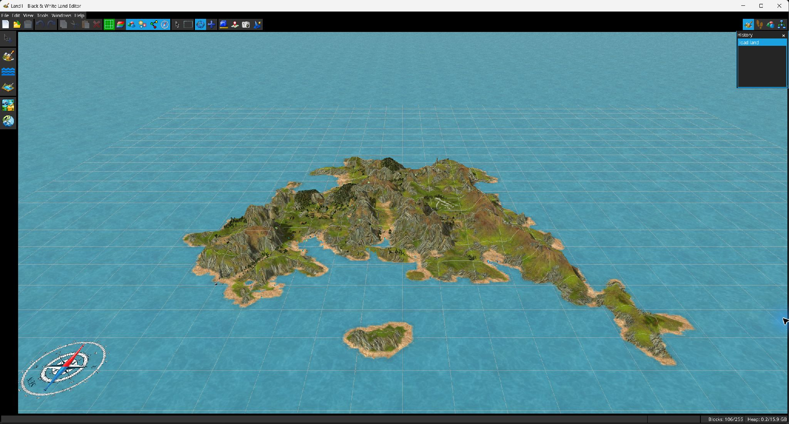
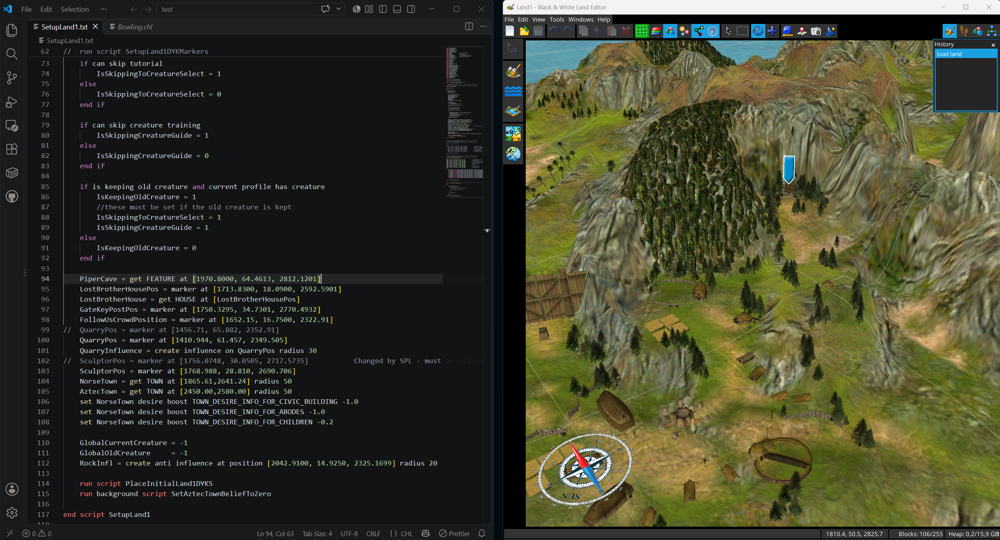

# Black & White Land Editor

**BWLandEditorGUI** is a graphical editor for creating and modifying landscapes and related LHX data for *Black & White*.

It provides a 3D editing environment for terrain sculpting, materials and countries, water, environmental sounds, object placement, LHX scripting, import/export operations, and project recovery. It also integrates with **Visual Studio Code** for editing CHL challenge scripts and working with map coordinates directly from the code.

## Features

- **Interactive 3D landscape editing**
  - Orbit, pan and top/orthographic views
  - Grid, cell attributes, objects, links and compass overlays
  - Free selection and terrain movement tools

- **Terrain sculpting**
  - Absolute and relative sculpting
  - Flatten, smooth and terrace modes
  - Configurable brush shape, size, flow, smoothness and rotation
  - Cliff and coastline configuration

- **Landscape painting**
  - Country painting
  - Environmental sound painting
  - Ocean and lake tools
  - Slope and altitude filters

- **Materials and countries**
  - Material editor
  - Country editor and material mixer
  - Import, export, duplication and replacement
  - Noise map and coastline bump map editing
  - Terrain shadow updates

- **Import and export**
  - Open and save `.lnd` landscapes
  - Open and save LHX `.txt` scripts
  - Import parts of another landscape
  - Import PNG height maps
  - Export height maps
  - Capture screenshots of the 3D viewport

- **Object placement**
  - Object catalog with drag-and-drop placement
  - Select, move, copy, cut, paste and delete objects
  - Edit object attributes and hierarchy
  - Work with towns, flocks, forests and related LHX objects

- **LHX editing**
  - Script editor
  - Tree view
  - Search and navigation
  - Command completion
  - Land and gameplay attributes

- **CHL scripting with Visual Studio Code**
  - Syntax highlighting and language support for `.chl` challenge scripts
  - Preview script coordinates as temporary markers in the Land Editor
  - Pick positions on the map and insert their coordinates into a CHL script in VS Code
  - Install or update the companion VS Code extension from the Land Editor

- **Utility tools**
  - Random landscape generator
  - Block inspector
  - Edit history
  - Console output
  - Camera information
  - Model viewer
  - Autosave and automatic recovery

- **Multiple languages**
  - English
  - Italian
  - French
  - German
  - Spanish

## CHL scripting with Visual Studio Code

In addition to editing landscapes and LHX data, Black & White Land Editor can work alongside **Visual Studio Code** to make writing **CHL (Challenge Language)** scripts easier.

*Write CHL scripts in Visual Studio Code while visualizing and selecting coordinates directly on the Land Editor's 3D map.*

The companion **CHL Language** extension provides syntax highlighting for `.chl` files and a two-way connection between your script and the Land Editor's 3D map:

- **From script to map:** Place the text cursor inside a coordinate expression in VS Code. The Land Editor displays a temporary marker at that position, making it easier to see where a scripted event takes place. Moving the cursor away clears the marker.
- **From map to script:** Choose a position in the Land Editor using its coordinate-selection feature. The coordinates are sent to VS Code, where they replace the coordinate expression under the cursor, or are inserted at the cursor when no coordinate expression is present.

This allows you to write the logic of a challenge in VS Code while using the Land Editor to visually inspect and select locations, without repeatedly copying coordinates by hand.

### Install the VS Code extension

1. Install **Visual Studio Code** if it is not already available.
2. Start **Black & White Land Editor** and open **Preferences → Integrations**.
3. Click **Install / Update Extension** to install the bundled CHL Language extension.
4. Open a `.chl` script in VS Code and keep the Land Editor running to use coordinate integration.

The extension can also be installed manually from its `.vsix` package using **Extensions: Install from VSIX...** in VS Code.

By default, the applications communicate over HTTP on the local machine (Land Editor port `8085`, VS Code extension port `8086`). The ports and connection URL can be configured if needed.

The extension source code and its detailed configuration instructions are available in [`vscode-chl/`](vscode-chl/).

## Documentation

The complete user guide is available in the `docs` directory and includes screenshots and descriptions of the editor tools.

Documentation is available in:

- [English](https://daniels118.github.io/BWLandEditor/)
- [Italiano](https://daniels118.github.io/BWLandEditor/it/index.htm)
- [Français](https://daniels118.github.io/BWLandEditor/fr/index.htm)
- [Deutsch](https://daniels118.github.io/BWLandEditor/de/index.htm)
- [Español](https://daniels118.github.io/BWLandEditor/es/index.htm)

The `docs` directory can also be used as the source directory for GitHub Pages.

## Getting started

1. Start the editor.
2. Create a new project or open an existing `.lnd` landscape or LHX `.txt` script.
3. Configure the *Black & White* game directory in **Preferences** when access to game resources such as the object catalog is required.
4. Edit the landscape, place objects and modify the LHX script as needed.
5. Save the landscape and script from the **File** menu.

For detailed instructions, see the [user guide](https://daniels118.github.io/BWLandEditor/).

To work on CHL challenge scripts, follow the [Visual Studio Code integration instructions](#chl-scripting-with-visual-studio-code).

## Main editing workflow

A typical landscape editing workflow is:

1. Define or import materials and countries.
2. Sculpt the terrain.
3. Create oceans and lakes.
4. Paint countries and environmental sounds.
5. Place and configure LHX objects.
6. Edit the LHX initialization script and land attributes.
7. Save the landscape and script.

## Technology

BWLandEditorGUI is written in **Java** and uses **LibGDX** for its graphical interface and 3D rendering.

The optional CHL Language extension for Visual Studio Code is written in **TypeScript** and communicates with the Land Editor through local HTTP endpoints.

## License

Copyright © 2024–2026 **Daniele Lombardi / Daniels118**.

This project is free software distributed under the **GNU General Public License, version 3 or, at your option, any later version**.

See the repository license file for the complete license text.
